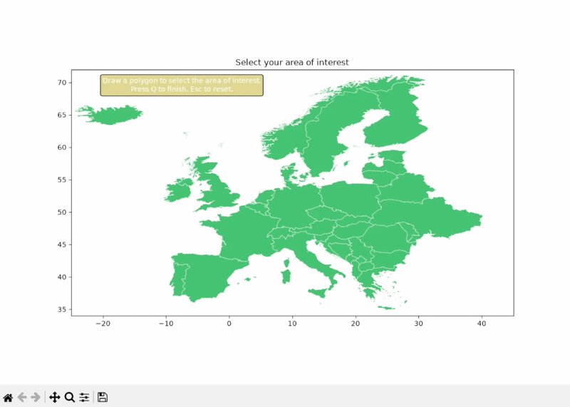
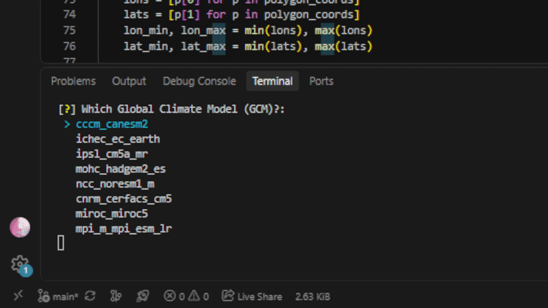
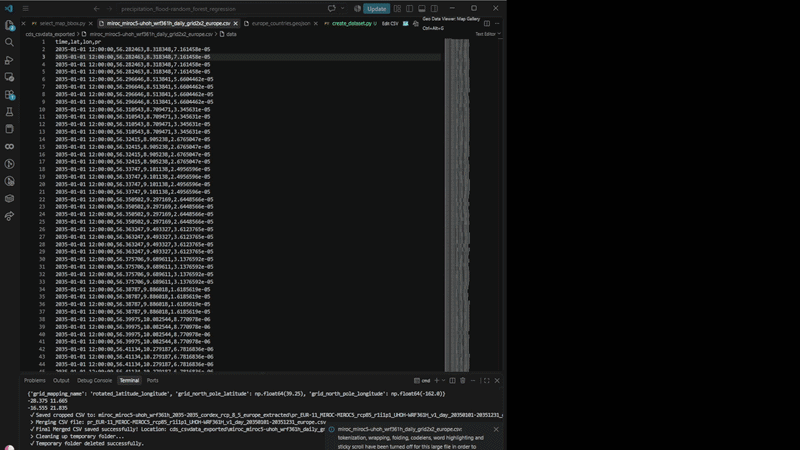

# precipitation_flood_-random_forest_regression
This repository is for downloading precipitation data and creating a dataset in the final form of CSV for regression (such as scikit-learn Random Forest regression)

# Create flood maps based on precipitation (projection data)
## A. Download rainfall CORDEX data and select aera of interest
1. Run `cordex_request.py`: It use CDS - [CORDEX regional climate model data on single levels](https://cds.climate.copernicus.eu/datasets/projections-cordex-domains-single-levels)'s API to download the selected data. We are fetching the mean precipitation flux in Europe, without Russia because of the country's size.
2. Run `read_cordex.py`: Transforming the downloaded data for a specified bounding box, which the user draws in a pop-up window (from `select_map_bbox.py`) - since the final CSV file for the whole Europe may exceed 2GB.
    
    - a. Select BBOX for area of interest. 

    

    - b. Select parameters of the downloaded CDS zip file (similar selection as in `cordex_request.py`)
    

    - c. Checking results

        

## B. Create ground truth dataset with historical rainfall

1. Run `create_dataset.py`: Creates points based on European historical flood data.

    *<u>*important note:</u>* Get/Create a GEE project to use in this script.

     Data (TIF images) are downloaded from [ftp_CEMS-EFAS](https://jeodpp.jrc.ec.europa.eu/ftp/jrc-opendata/CEMS-EFAS/European_Satellite-Derived_Flood_Depth_Maps/maps/) in directory `../floods_datasets/ftp_CEMS-EFAS`. These images have the depth [cm] of the flood. Script creates points with customized spacing based on the pixels that have >= 50cm flood depth. Then elevation and land use data are added from Google Earth Engine:
    - Elevation [m]
    - Slope [deg] (calculated from elevation)
    - LULC (Land Use / Land Cover)

    and data about drainage density and precipitation from *local* datasets:
    - Drainage density [km/km^2] is calculated from European data of basins and rivers. Downloaded from: [Hydrosheds-Basins](https://www.hydrosheds.org/products/hydrobasins) and [Hydrosheds-Rivers](https://www.hydrosheds.org/products/hydrorivers)
     *<u>*note:</u>* After downloading, these 2 zip files should be extracted in the same directory as this repository.
    - Mean precipitation (rainfall) from CREOTech's server and [Euro CORDEX precipitation](https://cds.climate.copernicus.eu/datasets/projections-cordex-domains-single-levels) data, for specified year or range of years as inputed.
        
        *<u>*note:</u>* In `cordex_request` you can change any of the parameters like 'experiment', 'horizontal_resolution', etc.
    
     
2. Run `rfRegressor.py`

## C. Create future datasets with future rainfall
1. Run `timeseries_create_points.py` - select the desired port, RCM: Creates random points based on *local* shapefile of the port and most of the data needed for `create_dataset`: elevation, slope, lulc, drainage density, precipitation
2. Run `timeseries_inference.py` - select the desired port, RCM: Exports csv files and matching TIF images.

---
If there are missing precipitation data (like in Bretagne) and need to be created:
1. Run `cordex_request` - modify any parameters needed: This downloads zip files of the [CORDEX regional climate model data on single levels](https://cds.climate.copernicus.eu/datasets/projections-cordex-domains-single-levels)
2. Run `read_cordex` - select desried RCM and RCP model: Exports one final CSV with date-time, location, precipitation values.
